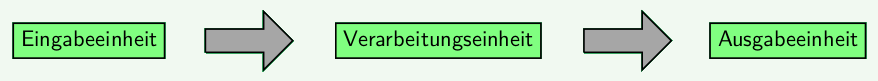

#### Kategorisierung nach dem EVA-Prinzip

1. Lies den Infokasten zum EVA-Prinzip, der unten abgebildet ist.
2. Hardware: Kategorisiere die Bauteile auf dem Calliope danach, ob sie für die Eingabe, die Verarbeitung oder die Ausgabe zuständig sind.
3. Software: Kategorisiere die Befehle im folgenden Programm danach, ob sie für die Eingabe, die Verarbeitung oder die Ausgabe zuständig sind.

<!-- Tabs für die Auswahl -->

  <button class="tab-button" data-umgebung="makecode">Makecode</button>
  <button class="tab-button" data-umgebung="roberta">Open Roberta Lab</button>
  <button class="tab-button" data-umgebung="python">Python</button>

<!-- Inhalte für jede Programmierumgebung -->

  

  

  

  

  

<pre><code class="language-python">
# Imports go at the top
from calliopemini import *
import neopixel
import music
np = neopixel.NeoPixel(pin_RGB, 3)

# Code in a 'while True:' loop repeats forever
while True:
    display.scroll('hi!')
    if temperature() &lt; 20:
        np.fill((0,0,255))
        np.show()
    else:
        np.fill((255, 125,0))
        np.show()
    music.play(['c'])
    while not( button_a.is_pressed() ):
        pass
</code></pre>
  

#### Das EVA-Prinzip

Informationsverarbeitende Systeme lassen sich nach ihrer Funktion in drei Einheiten zerlegen: Eingabeeinheit, Verarbeitungseinheit, Ausgabeeinheit.

Mit dem EVA-Prinzip wird die grundlegende Reihenfolge der Verarbeitung von Daten charakterisiert. Dies kann sowohl auf Hardwareebene (Bauteile) als auch auf Softwareebene (Programm) geschehen.

<!-- Tabs für die Auswahl -->

  <button class="tab-button" data-umgebung="makecode">Makecode</button>
  <button class="tab-button" data-umgebung="roberta">Open Roberta Lab</button>
  <button class="tab-button" data-umgebung="python">Python</button>

<!-- Inhalte für jede Programmierumgebung -->

  

  

  

  

  

  

#### Bauteilkunde

Elektronische Bauteile und die von ihnen verarbeiteten Signale lassen sich jeweils grob in zwei Kategorien aufteilen: Es gibt Sensoren und Aktoren und es gibt analoge und digitale Signale.

Versuche, die folgenden Bauteile des Calliope aus eigener Überlegung zu kategorisieren, indem du sie passend in die folgende Tabelle einträgst. Achtung: Manche Bauteile lassen sich je nach Nutzung auch in zwei Felder eintragen.

- Taste A und Taste B
- Berührungspins (goldene Ringe)
- LED-Matrix (5×5 Display)
- RGB-LED
- Lautsprecher
- Mikrofon
- Lichtsensor
- Temperatursensor
- Kompass (Magnetometer)
- Beschleunigungssensor und Gyroskop

 |          | Sensor | Aktor |
 |---------|--------|-------|
 | Digital |        |       |
 | Analog  |        |       |

!!!! #### Sensoren und Aktoren mit digitalen und analogen Signalen
!!!!
!!!! Für die Eingabe von Daten werden *Sensoren* benötigt; für die Ausgabe hingegen *Aktoren*:
!!!! 
!!!! -   **Sensoren** (auch Fühler genannt) sind elektrische Bauteile, die eine physikalische Größe aus der Umwelt (Temperatur, Helligkeit, Luftdruck oder auch ein mechanischer Druck mit dem Finger) in eine elektrische Größe (Widerstand, Spannung, Stromstärke) umwandeln. Dadurch werden die physikalischen Größen aus der Umwelt einer elektronischen Verarbeitung zugänglich.
!!!! -   **Aktoren** (auch Aktuatoren genannt) sind elektrische Bauteile, die eine elektrische Größe in eine mechanische (Bewegung, Schallwellen) oder andere Größe (Temperatur, Licht, …) umwandeln. Sie ermöglichen, dass die elektronische Verarbeitung zu Handlungen bzw. Konsequenzen führen kann.
!!!! 
!!!! Die Signale von Sensoren und Aktoren können digital oder analog sein:
!!!! 
!!!! -   **Digitale Signale** können nur bestimmte, abgestufte Werte annehmen. In unseren Anwendungen genügen meist zwei Zustände - z.B. an / aus, gedrückt / nicht gedrückt oder 1 / 0.
!!!! -   **Analoge Signale** sind kontinuierlich: Sie ändern sich zeitlich und wertmäßig stufenlos und können dadurch unendlich viele Werte annehmen.
!!!! 
!!!! Digitale Geräte wie der Calliope können analoge Signale nicht exakt, sondern nur näherungsweise verarbeiten:
!!!! 
!!!! -   Beim **Einlesen** wandelt der Calliope die analoge Spannung am Eingang in eine Zahl um. Dabei sind 1024 verschiedene Stufen (0 bis 1023) möglich - der Calliope löst analoge Signale also mit 10 Bit auf. Diese Auflösung ist für die meisten Aufgaben fein genug.
!!!! -   Beim **Ausgeben** erzeugt der Calliope keine echten Zwischenwerte, sondern schaltet die Ausgabe sehr schnell ein und aus (Pulsweitenmodulation, kurz PWM). Über das Verhältnis von Ein- und Ausschaltzeit lässt sich dennoch die Helligkeit einer LED oder die Lautstärke des Lautsprechers stufenlos regeln.
!!!! 
!!!! 

